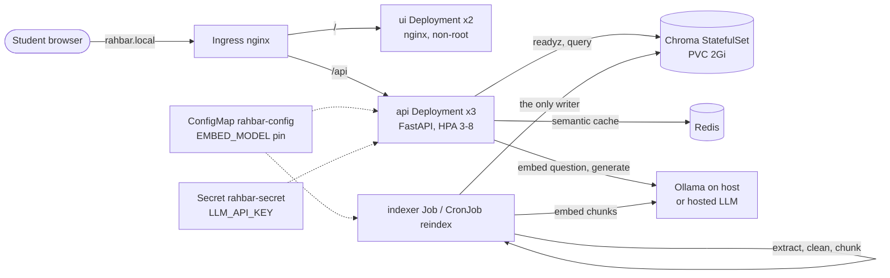

# RAHBAR: grounded answers about FAST-NUCES rules, on Kubernetes

[](https://github.com/mominkhawaja-codes/rahbar-rag-kubernetes/actions/workflows/ci.yml)
[](https://github.com/mominkhawaja-codes/rahbar-rag-kubernetes/actions/workflows/cd.yml)

Students at FAST-NUCES ask the same questions every semester: what CGPA puts me on
academic warning, how much absence can be condoned, what the fee per credit hour is.
The answers are spread over long PDFs, some of them scanned, some superseded by a newer
edition with different numbers. RAHBAR answers those questions **only from the
university's own documents**: every answer cites the clause it came from, a repealed rule
is never quoted as current, and when the documents do not cover a question (hostel rules,
for example) it says so instead of guessing. It runs as a set of small services on
Kubernetes: an indexer Job builds a vector index in Chroma, three API replicas answer
from it, and a semantic cache in Redis serves repeated questions without calling the model.

## Architecture



All of it lives in the `rahbar` namespace behind a deny-by-default NetworkPolicy. Chroma
and Redis are ClusterIP only. The API never writes the index (ADR 0001): the indexer
builds a complete new collection and swaps it in, so the API never serves a half-built index.

**The query path** (`api/app/services/answer.py`): semantic cache → retrieve top-k with
superseded documents filtered out → relevance floor (nothing relevant → decline without
calling the model) → generate against the `Answer` JSON schema with one retry → safe
fallback on failure → citation check → cache the answer unless it is an abstention, a
fallback or a follow-up.

## From a clean clone to an answered question

Prerequisites: Docker, minikube, kubectl, make and Python 3.12. On Windows, use WSL 2.
Ollama runs on the host:

```bash
OLLAMA_HOST=0.0.0.0 ollama serve          # in its own terminal
ollama pull nomic-embed-text && ollama pull llama3.2:3b
```

```bash
git clone https://github.com/mominkhawaja-codes/rahbar-rag-kubernetes.git && cd rahbar-rag-kubernetes
make install                    # .venv with the api, indexer and dev dependencies
make test                       # unit tests: stubs only, no cluster, no model
make fetch                      # downloads corpus/sources.yaml into corpus/raw/ (gitignored)
make cluster                    # minikube with Calico, metrics-server and ingress
make images                     # stages the corpus, builds the 3 images, loads them into minikube
make apply                      # kubectl apply -k k8s/overlays/dev (the indexer Job starts by itself)
kubectl -n rahbar get jobs -w   # wait for the `indexer` Job to be Complete
kubectl -n rahbar rollout status deployment/api
echo "$(minikube ip) rahbar.local" | sudo tee -a /etc/hosts
make ask Q="What CGPA does an undergraduate need to stay off academic warning?"
```

On macOS or Windows with the docker driver, run `minikube tunnel` in another terminal and
use `make ask INGRESS_IP=127.0.0.1 Q="..."`. Then open http://rahbar.local.

To use a hosted model instead of Ollama, create the Secret from the command line (never a
file): `export LLM_API_KEY=...; make secret`, and set `LLM_PROVIDER=hosted` and
`HOSTED_BASE_URL` in the ConfigMap.

### The exact apply order

`kubectl apply -k k8s/overlays/dev` applies everything at once, and kustomize orders it.
Applied by hand, the order and the reason for it are:

```bash
kubectl apply -f k8s/base/namespace.yaml          # 1. everything else lives in it
kubectl apply -f k8s/base/configmap.yaml          # 2. pods read it at start-up
make secret                                       # 3. only for LLM_PROVIDER=hosted
kubectl apply -f k8s/base/networkpolicy.yaml      # 4. deny-by-default before any pod runs
kubectl apply -f k8s/base/chroma.yaml             # 5. the store, with its PVC
kubectl apply -f k8s/base/redis.yaml              # 6. the cache
kubectl apply -f k8s/base/indexer-job.yaml        # 7. builds the index (waits for Chroma)
kubectl apply -f k8s/base/indexer-cronjob.yaml    # 8. weekly re-index; `make index` runs it now
kubectl apply -f k8s/base/api.yaml                # 9. not ready until the index exists and the pin matches
kubectl apply -f k8s/base/ui.yaml                 # 10.
kubectl apply -f k8s/base/ingress.yaml            # 11. last: route traffic only to what exists
```

Applied in this order, the base files use the image tag `dev`. The overlays only change
tags and ConfigMap values.

### Without a cluster

```bash
make dev            # API with stub retriever and stub LLM on http://localhost:8000, plus the UI
make eval-fixtures  # in another terminal: the evaluation runner against it
make dry-run        # extract, clean and chunk the real corpus; prints statistics
make check          # the submission checker
```

## API

| Method | Path | Purpose |
| --- | --- | --- |
| POST | `/api/ask` | `{"question": "..."}` (3 to 500 characters) → `AskResponse`: answer, citations, `answered_from_context`, confidence, retrieved passages with scores, provider, `cached`. `X-Cache: hit\|miss` header. 422 on invalid input, 503 naming the dependency when Chroma or the embedding model is down or the embedding pin does not match. |
| GET | `/healthz` | Liveness. Touches nothing, so a slow Chroma never restarts API pods. |
| GET | `/readyz` | Readiness: Chroma heartbeat, collection exists and is non-empty, its `embed_model` equals `EMBED_MODEL`, Redis answers. 503 with the names of the failed checks. |
| GET | `/metrics` | Prometheus: requests and latency by route, retrieval and generation latency, top retrieval score, cache hits and misses, abstentions by reason, fallbacks, dropped citations. |

Every request carries an `X-Request-ID` (sent or generated), echoed in the response and
on every JSON log line for that request.

## Configuration

Both programs read environment variables only, from `rahbar-config` (ConfigMap) and
`rahbar-secret` (Secret). Beyond the starter's keys:

| Variable | Default | Meaning |
| --- | --- | --- |
| `RELEVANCE_FLOOR` | `0.45` | Cosine similarity below which a passage never reaches the model |
| `CACHE_BACKEND` | `redis` on the cluster, `memory` locally | `redis`, `memory` or `none` |
| `REDIS_URL` | `redis://redis:6379/0` | |
| `CACHE_THRESHOLD` | `0.95` | Question similarity for a semantic cache hit |
| `CACHE_TTL` | `86400` | Seconds |
| `LLM_TIMEOUT` | `60` | Seconds per LLM attempt |
| `HOSTED_JSON_MODE` | `json_object` | `json_schema` where the provider supports strict schemas |
| `OCR_ENABLED` | `true` | `false` only for a local dry run without Tesseract |
| `CHUNK_SIZE`, `CHUNK_OVERLAP` | `400`, `50` | In whitespace-separated words |

## Repository

```
api/        FastAPI service: reads the index, never writes it   (Dockerfile, tests/)
indexer/    the Job: extract → clean → chunk → embed → store     (Dockerfile, tests/)
ui/         static chat page + nginx config                       (Dockerfile)
k8s/        base/ and overlays/{dev,prod,ci}/ (kustomize)
eval/       golden.yaml, run_eval.py, fixtures/ for CI, tests/
corpus/     fetch.py, sources.yaml, MANIFEST.md (documents themselves are not committed)
docs/       CORPUS, PIPELINE, FAILURE-ANALYSIS, ENGINEERING-NOTES, AI-USAGE, adr/, evidence/
.github/    ci.yml (lint, tests, kubeconform, Trivy, kind e2e eval gate), cd.yml (Docker Hub, deploy)
```

How the objects fit together, why Chroma is a StatefulSet and how the embedding pin is enforced: [docs/ARCHITECTURE.md](docs/ARCHITECTURE.md).

Design decisions are in `docs/adr/`: [0001 indexer as a Job](docs/adr/0001-indexer-as-job.md),
[0002 chunking](docs/adr/0002-chunking.md), [0003 cache store](docs/adr/0003-semantic-cache-store.md),
[0004 LLM provider and PII](docs/adr/0004-llm-provider-and-pii.md).

## Screenshot


