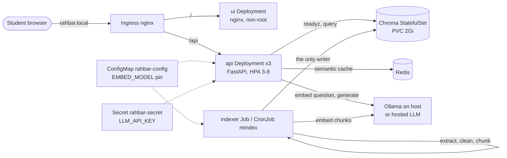

# RAHBAR: grounded answers about FAST-NUCES rules, on Kubernetes

[](https://github.com/mominkhawaja-codes/rahbar-rag-kubernetes/actions/workflows/ci.yml)
[](https://github.com/mominkhawaja-codes/rahbar-rag-kubernetes/actions/workflows/cd.yml)

Students at FAST-NUCES ask the same questions every semester: what CGPA puts me on
academic warning, how much absence can be condoned, what the fee per credit hour is.
The answers are spread over long PDFs, some of them scanned, some superseded by a newer
edition with different numbers. RAHBAR answers those questions **only from the
university's own documents**: every answer cites the clause it came from, a repealed rule
is never quoted as current, and when the documents do not cover a question (hostel rules,
for example) it says so instead of guessing. It runs as a set of small services on
Kubernetes: an indexer Job builds a vector index in Chroma, three API replicas answer
from it, and a semantic cache in Redis serves repeated questions without calling the model.

## Architecture



All of it lives in the `rahbar` namespace behind a deny-by-default NetworkPolicy. Chroma
and Redis are ClusterIP only. The API never writes the index (ADR 0001): the indexer
builds a complete new collection and swaps it in, so the API never serves a half-built index.

**The query path** (`api/app/services/answer.py`): semantic cache → retrieve top-k with
superseded documents filtered out → relevance floor (nothing relevant → decline without
calling the model) → generate against the `Answer` JSON schema with one retry → safe
fallback on failure → citation check → cache the answer unless it is an abstention, a
fallback or a follow-up.

Grounded answers include an inline `[source / section]` reference on each factual
sentence. The API resolves the sentence's passage numbers using the same citation check
that supplies the UI's Sources list.

## From a clean clone to an answered question

The dev API serves the nine-document FAST-NUCES corpus in `rahbar-fast-public`. It uses
Groq for generation and host Ollama for embeddings. The default dev setup indexes the
original documents. The optional [snapshot setup](#optional-snapshot-setup) imports the
612 existing vectors, passages and metadata.

Use the default indexing setup on a fresh Minikube cluster. Applying it to a cluster
with an existing public index can replace that index. Use `dev-snapshot` to retain a
seeded deployment and apply without `--prune` so its existing resources are retained.
Create the namespace and Groq Secret before running `kubectl apply` on either overlay.

### Windows PowerShell

Use Docker Desktop with Linux containers, Minikube, kubectl, Python 3.12 and Ollama. Make is optional
on Windows. Ensure the Minikube executable is on `PATH`. If it was installed at
`C:\minikube\minikube.exe`, use that full path in the commands below.

Start Ollama in its own PowerShell terminal with `$env:OLLAMA_HOST = '0.0.0.0'; ollama serve`.
If the Ollama tray app is already serving, quit it before starting the foreground server.
From the repository root in a second terminal, run:

```powershell
ollama pull nomic-embed-text
minikube start --driver=docker --cni=calico --memory=3072 --cpus=4
minikube addons enable metrics-server
minikube addons enable ingress
minikube ssh -- curl -fsS http://host.minikube.internal:11434/api/version

kubectl --context minikube apply -f k8s/base/namespace.yaml
```

Create the Groq Secret from a masked prompt. Skip this block when the namespace already
has a working `rahbar-secret`.

```powershell
$secret = Read-Host 'Groq API key' -AsSecureString
try {
    $keyBytes = [Text.Encoding]::UTF8.GetBytes([Net.NetworkCredential]::new('', $secret).Password)
    @{
        apiVersion = 'v1'; kind = 'Secret'; type = 'Opaque'
        metadata = @{ name = 'rahbar-secret'; namespace = 'rahbar' }
        data = @{ LLM_API_KEY = [Convert]::ToBase64String($keyBytes) }
    } | ConvertTo-Json -Depth 4 -Compress |
        kubectl --context minikube apply --server-side --field-manager=rahbar-secret-setup -f -
    if ($LASTEXITCODE -ne 0) { throw 'Secret setup failed' }
} finally {
    if ($keyBytes) { [Array]::Clear($keyBytes, 0, $keyBytes.Length) }
    $secret.Dispose()
}
```

For normal ingestion, place the reviewed nine source files and `_index.json` in
`corpus/raw`. Use a verified team copy or, if the files are missing, use the downloader.
Compare the sources with [the recorded corpus manifest](corpus/MANIFEST.md).

```powershell
# Run these two commands only if you need to fetch the sources.
python -m pip install httpx PyYAML
python corpus/fetch.py
if ($LASTEXITCODE -ne 0) { throw 'FAST corpus download failed' }
```

Stage the corpus with `make stage-corpus` if you have Make, or use the PowerShell
equivalent below from a clean indexer build context.

```powershell
$documents = Get-Content -Raw corpus/raw/_index.json | ConvertFrom-Json
if ($documents.Count -ne 9) { throw 'Expected nine FAST corpus sources' }
$expected = @($documents.file) + '_index.json' + '.gitkeep'
$unexpected = Get-ChildItem -Force indexer/corpus | Where-Object { $_.Name -notin $expected }
if ($unexpected) { throw 'Unexpected files in indexer/corpus. Review them before building.' }
foreach ($file in @($documents.file) + '_index.json') {
    Copy-Item -LiteralPath (Join-Path 'corpus/raw' $file) -Destination indexer/corpus -ErrorAction Stop
}
```

Build and load the three images, then apply to the fresh cluster.

```powershell
foreach ($component in 'api', 'ui', 'indexer') {
    docker build --tag "rahbar-${component}:dev" $component
    if ($LASTEXITCODE -ne 0) { throw "Build failed for $component" }
    minikube image load "rahbar-${component}:dev"
    if ($LASTEXITCODE -ne 0) { throw "Image load failed for $component" }
}
kubectl --context minikube apply -k k8s/overlays/dev
kubectl --context minikube -n rahbar wait --for=condition=complete job/indexer --timeout=65m
kubectl --context minikube -n rahbar rollout status deployment/api --timeout=360s
kubectl --context minikube -n rahbar rollout status deployment/ui --timeout=180s
```

Run `minikube tunnel` in a separate elevated PowerShell terminal. Add
`127.0.0.1 rahbar.local` to `%SystemRoot%\System32\drivers\etc\hosts` once, then open `http://rahbar.local`
and ask what CGPA puts an undergraduate on academic warning. Expect **2.00** with an
inline citation to the 2026 Academic Rules Handbook PDF. The node
budget is **3072 MiB and four CPUs**. Docker Desktop and Windows need additional headroom
for Ollama and other processes.

### Linux and macOS with Make

Install Docker, Minikube, kubectl, make, Python 3.12 and Ollama.

```bash
OLLAMA_HOST=0.0.0.0 ollama serve          # in its own terminal
ollama pull nomic-embed-text
```

```bash
git clone https://github.com/mominkhawaja-codes/rahbar-rag-kubernetes.git && cd rahbar-rag-kubernetes
make install                    # .venv with the api, indexer and dev dependencies
make test                       # unit tests: stubs only, no cluster, no model
make cluster                    # minikube with Calico, metrics-server and ingress
kubectl --context minikube apply -f k8s/base/namespace.yaml
# Set LLM_API_KEY securely in this shell before running make secret.
make secret                     # creates the rahbar-secret Secret used by the API
# Use the reviewed sources and _index.json in corpus/raw, or run make fetch if missing.
make images                     # stage the corpus, then build and load all three images
kubectl --context minikube apply -k k8s/overlays/dev
kubectl --context minikube -n rahbar wait --for=condition=complete job/indexer --timeout=65m
kubectl --context minikube -n rahbar rollout status deployment/api --timeout=360s
kubectl --context minikube -n rahbar rollout status deployment/ui --timeout=180s
```

`make cluster` defaults to 3072 MiB. Set `MINIKUBE_MEMORY` to choose a different budget
on a machine with more available memory. On Linux, map `rahbar.local` to the IP shown
by `minikube ip` in `/etc/hosts` and run `make ask Q="What CGPA puts a student on academic warning?"`.
On macOS with the Docker driver, run `minikube tunnel` in another terminal, map
`rahbar.local` to `127.0.0.1` in `/etc/hosts`, and pass `INGRESS_IP=127.0.0.1` to `make ask`.

Use a Groq free-tier key for `LLM_API_KEY`. Use a masked prompt or your shell's secret
manager. Keep the key out of Git and shell history. Hosted generation sends the user
question and retrieved excerpts to Groq, so use public corpus material and questions
without personal details.

To deliberately switch generation back to local Ollama, load `llama3.2:3b` on the host
and override only the API's generation settings:

```bash
kubectl -n rahbar set env deployment/api LLM_PROVIDER=ollama-host LLM_MODEL=llama3.2:3b LLM_TIMEOUT=240
kubectl -n rahbar rollout status deployment/api
```

For a deployment configured by the dev overlay, remove these three overrides with
`kubectl -n rahbar set env deployment/api LLM_PROVIDER- LLM_MODEL- LLM_TIMEOUT-`
to resume hosted generation.

### Optional snapshot setup

Get `fast-public-index.json` from the team and save it in the repository's parent
directory. Follow the cluster, Ollama and Secret setup above. Build and load only
the API and UI with `make app-images`, or use the Windows image loop with only
`'api', 'ui'`. On a fresh cluster, run the commands below, keeping the port-forward
open in a separate terminal.

```shell
kubectl --context minikube apply -k k8s/overlays/dev-snapshot
kubectl --context minikube -n rahbar rollout status statefulset/chroma --timeout=300s
kubectl --context minikube -n rahbar port-forward --address 127.0.0.1 svc/chroma 18000:8000
```

Seed from the repository root, then close the port-forward and wait for the app.
On Linux or macOS, use `python3` if that is your Python command.

```shell
python scripts/fast_public_index.py seed ../fast-public-index.json
kubectl --context minikube -n rahbar rollout status deployment/api --timeout=360s
kubectl --context minikube -n rahbar rollout status deployment/ui --timeout=180s
```

For an existing fixture deployment, seed and verify the public collection before
applying `dev-snapshot`. See [snapshot export and rollback](docs/FAST-CORPUS-DEPLOYMENT.md).

### Development indexer and CI

The default dev overlay runs `job/indexer` once and schedules `cronjob/reindex`
weekly (`0 3 * * 0`). Both use the same indexer image and command, reading `/corpus`
and writing `rahbar-fast-public`. To refresh the scheduled inputs, stage the reviewed
sources and load the updated indexer image. The snapshot overlay omits the initial Job
and suspends the schedule. Keep it suspended on deployments that use the saved index.

CI uses `/fixtures`, the `rahbar` collection, stub generation and in-cluster embeddings.
Production keeps the base startup and UI settings and uses `/corpus` for its separate
indexer build.

GitHub CD publishes fixture-only indexer images and tests them with the CI overlay in
kind. The optional external deploy currently references that same image. Before
enabling the external job, wire it to a production indexer image with the reviewed
corpus at `/corpus`, configure a reachable Ollama endpoint for embeddings, and provision
`rahbar-secret` on the target cluster.

### Without a cluster

```bash
make dev            # API with stub retriever and stub LLM on http://localhost:8000, plus the UI
make eval-fixtures  # in another terminal: the evaluation runner against it
make dry-run        # extract, clean and chunk the real corpus; prints statistics
make check          # the submission checker
```

## API

| Method | Path | Purpose |
| --- | --- | --- |
| POST | `/api/ask` | `{"question": "..."}` (3 to 500 characters) → `AskResponse`: answer, citations, `answered_from_context`, confidence, retrieved passages with scores, provider, `cached`. `X-Cache: hit\|miss` header. 422 on invalid input, 503 naming the dependency when Chroma or the embedding model is down or the embedding pin does not match. |
| GET | `/healthz` | Liveness. Touches nothing, so a slow Chroma never restarts API pods. |
| GET | `/readyz` | Readiness: Chroma heartbeat, collection exists and is non-empty, its `embed_model` equals `EMBED_MODEL`, Redis answers. 503 with the names of the failed checks. |
| GET | `/metrics` | Prometheus: requests and latency by route, retrieval and generation latency, top retrieval score, cache hits and misses, abstentions by reason, fallbacks, dropped citations. |

Every request carries an `X-Request-ID` (sent or generated), echoed in the response and
on every JSON log line for that request.

## Configuration

Both programs read environment variables only, from `rahbar-config` (ConfigMap) and
`rahbar-secret` (Secret). Beyond the starter's keys:

| Variable | Default | Meaning |
| --- | --- | --- |
| `RELEVANCE_FLOOR` | `0.45` | Cosine similarity below which a passage never reaches the model |
| `CACHE_BACKEND` | `redis` on the cluster, `memory` locally | `redis`, `memory` or `none` |
| `REDIS_URL` | `redis://redis:6379/0` | |
| `CACHE_THRESHOLD` | `0.95` | Question similarity for a semantic cache hit |
| `CACHE_TTL` | `86400` | Seconds |
| `LLM_TIMEOUT` | `60` (`45` in the dev overlay) | Seconds for Ollama generation, shared by validation attempts. Hosted providers use it per attempt. |
| `HOSTED_JSON_MODE` | `json_object` | `json_schema` where the provider supports strict schemas |
| `OCR_ENABLED` | `true` | `false` only for a local dry run without Tesseract |
| `CHUNK_SIZE`, `CHUNK_OVERLAP` | `400`, `50` | In whitespace-separated words |

## Repository

```
api/        FastAPI service: reads the index, never writes it   (Dockerfile, tests/)
indexer/    the Job: extract → clean → chunk → embed → store     (Dockerfile, tests/)
ui/         static chat page + nginx config                       (Dockerfile)
k8s/        base/ and overlays/{dev,prod,ci}/ (kustomize)
eval/       golden.yaml, run_eval.py, fixtures/ for CI, tests/
corpus/     fetch.py, sources.yaml, MANIFEST.md (documents themselves are not committed)
docs/       CORPUS, PIPELINE, FAILURE-ANALYSIS, ENGINEERING-NOTES, AI-USAGE, adr/, evidence/
.github/    ci.yml (lint, tests, kubeconform, Trivy, kind e2e eval gate), cd.yml (Docker Hub, deploy)
```

How the objects fit together, why Chroma is a StatefulSet and how the embedding pin is enforced: [docs/ARCHITECTURE.md](docs/ARCHITECTURE.md).

Design decisions are in `docs/adr/`: [0001 indexer as a Job](docs/adr/0001-indexer-as-job.md),
[0002 chunking](docs/adr/0002-chunking.md), [0003 cache store](docs/adr/0003-semantic-cache-store.md),
[0004 LLM provider and PII](docs/adr/0004-llm-provider-and-pii.md).

## Screenshot


