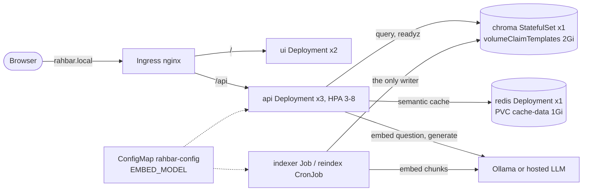

# Architecture

RAHBAR has two paths that never share a process: an **indexer** that writes the vector
store when the documents change, and an **API** that only reads it on every question.
Everything runs in the `rahbar` namespace (`k8s/base/`, overlays in `k8s/overlays/`).

## The objects

| Object | File | What it is, as configured |
| --- | --- | --- |
| `api` Deployment + Service + HPA + PDB | `k8s/base/api.yaml` | FastAPI, 3 replicas (`api.yaml:25`), rolling update with `maxSurge: 1, maxUnavailable: 0` (`:31`), startup/liveness on `/healthz`, readiness on `/readyz`, `preStop` sleep 5 s and a 40 s grace period. HPA 3 to 8 on CPU 70% (`:124-125`); PodDisruptionBudget `minAvailable: 2` (`:107`). Reads Chroma; never writes it. |
| `ui` Deployment + Service | `k8s/base/ui.yaml` | nginx-unprivileged serving `ui/index.html` on 8080, 2 replicas, read-only root filesystem with an `emptyDir` at `/tmp`. |
| `chroma` StatefulSet + 2 Services | `k8s/base/chroma.yaml` | `chromadb/chroma:1.0.12` (matches `chromadb-client==1.0.12`), 1 replica, `volumeClaimTemplates` of 2 Gi mounted at `/data`; ClusterIP Service `chroma` and headless Service `chroma-headless`. |
| `redis` Deployment + Service + PVC | `k8s/base/redis.yaml` | The semantic cache (ADR 0003). PVC `cache-data` (1 Gi), append-only file with fsync every second, `strategy: Recreate` because the ReadWriteOnce volume can only be mounted by one pod at a time. |
| `indexer` Job | `k8s/base/indexer-job.yaml` | One-shot: extract → clean → chunk → embed → store, then exit. `restartPolicy: OnFailure`, `backoffLimit: 3`, a 1 h deadline, and an init container that waits for Chroma's heartbeat. |
| `reindex` CronJob | `k8s/base/indexer-cronjob.yaml` | The same pod template, weekly (`0 3 * * 0`), `concurrencyPolicy: Forbid`. `make index` runs it now: `kubectl create job --from=cronjob/reindex ...`. |
| Ingress | `k8s/base/ingress.yaml` | Host `rahbar.local`: `/api` to `api:80`, `/` to `ui:80`, 120 s read timeout for generation. |
| ConfigMap `rahbar-config` | `k8s/base/configmap.yaml` | Every tunable, read by both the API and the indexer (`envFrom`), including `EMBED_MODEL`. |
| ServiceAccounts | `k8s/base/serviceaccounts.yaml` | One per workload, no token mounted, no RBAC (none of them calls the Kubernetes API). |
| NetworkPolicies | `k8s/base/networkpolicy.yaml` | Deny all by default; then DNS for every pod; ingress-nginx to `ui` and `api`; `api` to Chroma, Redis and the LLM ports; the indexer to Chroma and Ollama; Chroma accepts only `api` and indexer pods; Redis accepts only `api`. |

All Services are ClusterIP. All workload pods run as non-root with all capabilities
dropped, and set `enableServiceLinks: false`. That last setting is not cosmetic: with
service links on, Kubernetes injects `CHROMA_PORT=tcp://<ip>:8000` into every pod for the
`chroma` Service, and Chroma 1.x reads every `CHROMA_*` variable as its own configuration
and crash-loops. The CI end-to-end job found this (`docs/SECURITY.md`).

### The LLM: where Ollama runs

The provider is chosen by `LLM_PROVIDER` (ADR 0004); the overlays set it.

- **dev** (`k8s/overlays/dev`): `ollama-host`, so Ollama on the laptop at
  `http://host.minikube.internal:11434` (run with `OLLAMA_HOST=0.0.0.0`), for both
  embeddings and generation. Nothing runs Ollama inside minikube.
- **ci** (`k8s/overlays/ci`): an `ollama` Deployment *inside* the kind cluster, used for
  embeddings only (`nomic-embed-text`). Its models live in an `emptyDir`, so they are
  re-pulled on each run; there is no PVC. Generation in CI uses the `stub` provider, so no
  test depends on a model's wording.
- **prod** (`k8s/overlays/prod`): `hosted`, an OpenAI-compatible endpoint, with the key
  only in the `rahbar-secret` Secret created from the command line.

## Why Chroma is a StatefulSet, not a Deployment

The index is the one piece of state in RAHBAR that is expensive to rebuild: OCR on 35
scanned pages and an embedding for each of about 600 chunks. It has to survive a pod
being deleted, rescheduled or upgraded.

1. **Each replica gets its own claim, and that claim follows the pod's identity.**
   `volumeClaimTemplates` (`chroma.yaml:96-103`) makes the StatefulSet create PVC
   `data-chroma-0` for pod `chroma-0`. When `chroma-0` is deleted, the controller recreates
   a pod with the *same* name and binds it to the *same* claim, so the collection is still
   there and nothing has to re-index. A Deployment's pods have random names and no
   per-pod claims.
2. **No two copies of the store ever share a volume.** A Deployment that mounts one PVC
   would, during a rolling update, start a second Chroma process on the same data
   directory while the first is still running. Two writers on one data directory corrupt
   the store, or one of them waits forever for a ReadWriteOnce volume. A StatefulSet
   replaces `chroma-0` only after the old `chroma-0` has terminated (ordered updates), so
   only one Chroma process ever opens `/data`.
3. **A stable network identity.** `serviceName: chroma-headless` (`chroma.yaml:37`) gives
   the pod the DNS name `chroma-0.chroma-headless.rahbar.svc`. Clients use the ClusterIP
   Service `chroma`. The stable name is what would let replicas find one another if the
   store were ever sharded, which a Deployment cannot provide.

What this does **not** give us: high availability. There is one replica, so while
`chroma-0` restarts, `/readyz` fails on every API pod, they leave the Service, and the
Ingress answers 503 until Chroma is back. That is the honest cost of a single-node vector
store; Chroma's distributed mode would be the next step.

## Why indexing is a Job, not part of API start-up

The full argument is ADR 0001 (`docs/adr/0001-indexer-as-job.md`). In short:

- **One writer.** With indexing in API start-up, three API replicas would rebuild one
  collection at the same time, each halfway through a different document. The only code
  that writes Chroma is `indexer/pipeline/store.py`; the API never calls `.add()`.
- **Restarts stay cheap.** A rolling update, an OOMKill or an HPA scale-up starts API pods
  in seconds instead of re-running OCR and embeddings each time.
- **Readiness stays honest.** An API pod is ready when the index exists, is non-empty and
  matches its embedding model, not when it has finished building that index itself.
- **Re-indexing needs no redeploy.** `kubectl create job --from=cronjob/reindex ...`.
- **The live index is never half-written.** `store.py` builds the new index in
  `rahbar__staging`, checks its count, then renames live → `rahbar__previous` and staging
  → `rahbar` (`store.py:73-96`). A failed run leaves the live collection untouched.
- **Retries are Kubernetes' job:** `restartPolicy: OnFailure`, `backoffLimit: 3`. An
  OOMKilled indexer shows exit code 137 and the old index keeps serving.

The documents reach the Job inside its image (`make stage-corpus` copies `corpus/raw/`
into the build context), so an image tag identifies an exact corpus
(`docs/PIPELINE.md`).

## The embedding pin

Vectors from two different embedding models are not comparable, and the failure is
silent, so the model is pinned in one place and checked in code.

- **One source of truth.** `EMBED_MODEL: "nomic-embed-text"` lives in
  `k8s/base/configmap.yaml:12`. Both the API (`api/app/config.py:68`) and the indexer
  (`indexer/pipeline/config.py:23`) read it from that ConfigMap.
- **Same prefixes on both sides.** The indexer embeds `search_document: ...`
  (`indexer/pipeline/embed.py`); the API embeds `search_query: ...`
  (`api/app/embeddings.py`), nomic's task prefixes for the same model.
- **The index records what built it.** The indexer writes `embed_model`, `dimension` and a
  fresh `index_id` into the collection metadata (`indexer/pipeline/store.py:49-51`).
- **The API checks it three times** (`api/app/retrieval/chroma.py`):
  1. at start-up, `main.py:45-47` runs the readiness checks and logs
     `embedding pin check failed` with the reason;
  2. on every `/readyz`, `pin_problem` (`chroma.py:52`) compares the collection's
     `embed_model` with `EMBED_MODEL`; a mismatch or a missing record returns 503 with
     `embed_pin` named, so the pod stays `0/1 READY` and out of the Service;
  3. on every question, `retrieve` refuses with `EmbeddingPinMismatch` (`chroma.py:116`),
     and also when the question vector's length differs from the recorded `dimension`
     (`chroma.py:120`). `/api/ask` answers 503 instead of searching with incompatible
     vectors.

The pin is covered by unit tests (`test_embedding_model_mismatch_is_refused`,
`test_embedding_dimension_mismatch_is_refused`, `test_readyz_fails_when_the_pin_does_not_match`).
The live demonstration the handout asks for (change `EMBED_MODEL`, restart the API, watch
`0/1 READY`) has **not** been recorded yet; it needs a running cluster.

The same `index_id` drives cache invalidation: the semantic cache's key includes it, so a
re-index starts a fresh cache (ADR 0003).

## What has been verified, and where

| Claim | Evidence |
| --- | --- |
| The whole stack starts and answers on a real cluster | CI `e2e-eval` on kind: all pods `1/1 Running`, 3 API endpoints, HPA `cpu: 6%/70%` (`docs/evidence/`) |
| Indexer Job → readiness → eval gate | Same job: fixture index built by `reindex`, eval gate passes |
| Redis data survives a forced pod deletion | CI step "verify Redis persistence across a pod replacement" |
| Published images run | `cd.yml` `deploy-kind`: Docker Hub images by commit SHA, deployed and smoke-tested |
| Real-corpus retrieval quality | `eval-corpus` workflow, `eval/results.json` |
| Deployment on **minikube** with Calico | **Not verified by us**: our development machine could not run Docker. kind's default CNI also differs from Calico, so NetworkPolicy enforcement has not been demonstrated (e.g. that the ui pod cannot reach Chroma). |
| `ollama-host` mode against a laptop | **Not verified**, for the same reason |

The handout's network rule "api from the ui" is not a pod-to-pod rule here: the UI is
static files, and the browser calls `/api` through the Ingress, which is allowed. No ui
pod ever connects to the api pods.
